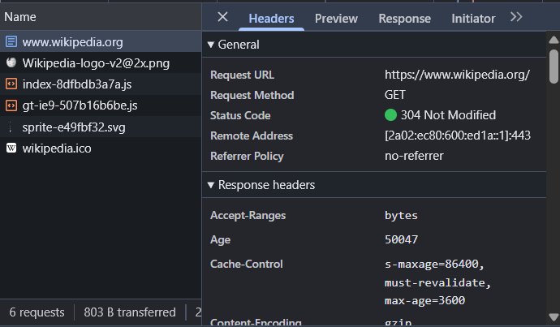
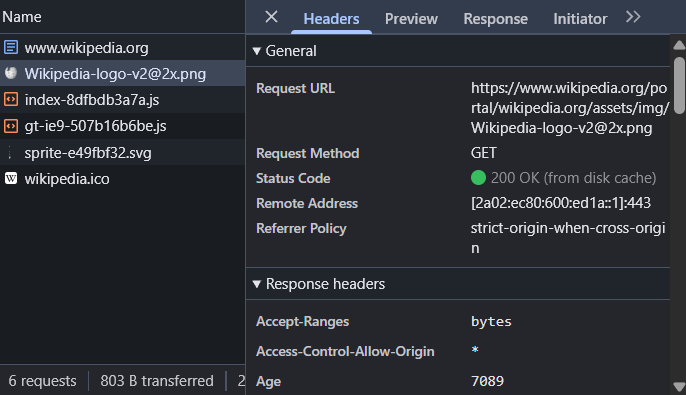
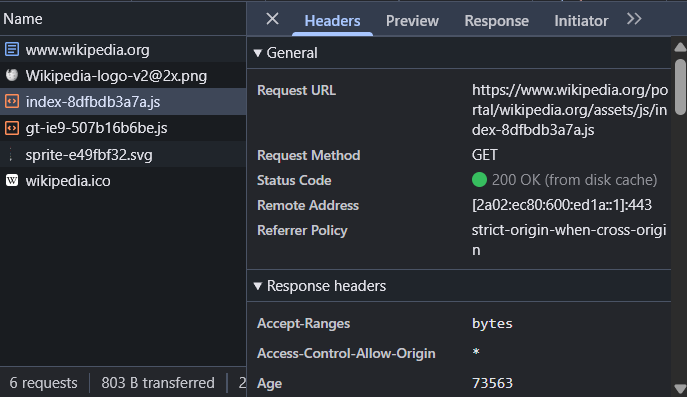

## Página web elegida

La página que he elegido para este proyecto es Wikipedia (https://www.wikipedia.org/)

## Frontend

En el frontend de Wikipedia se encuentran:

- La barra de búsqueda
- El menú de navegación
- El texto y las imágenes
- Los botones
- El diseño

## Backend

En el backend de Wikipedia están:

- La base de datos
- El servidor
- El sistema de búsqueda
- El sistema de usuarios
- El sistema de edición

## Modelo cliente-servidor

El modelo cliente servidor se resume a 5 pasos:

1. El cliente accede a Wikipedia
2. Se realiza una petición
3. El servidor recibe la petición
4. El servidor envía una respuesta a la petición
5. El cliente recibe la información y la muestra en pantalla

## Peticiones de DevTools

### Petición 1

- Método: GET.

- Código de estado: 304 Not Modified.

- Content-Type: text/html.

- Qué está pidiendo: El navegador solicita el documento HTML de la página principal de Wikipedia. El servidor indica que no ha cambiado y se puede utilizar la versión almacenada en caché.

### Petición 2

- Método: GET.

- Código de estado: 200 OK (from disk cache).

- Content-Type: image/png.

- Qué está pidiendo: El navegador solicita la imagen del logotipo de Wikipedia para mostrarla en la página. Se carga desde la caché del navegador.

### Petición 3

- Método: GET.

- Código de estado: 200 OK (from disk cache).

- Content-Type: text/javascript.

- Qué está pidiendo: El navegador solicita un archivo JavaScript que contiene código necesario para el funcionamiento y la interactividad de Wikipedia. Se obtiene desde la caché del navegador.
